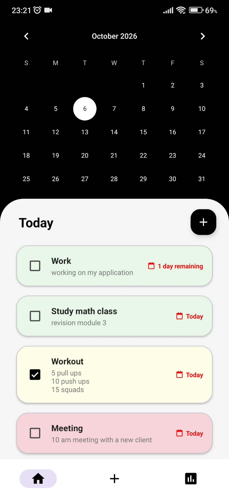
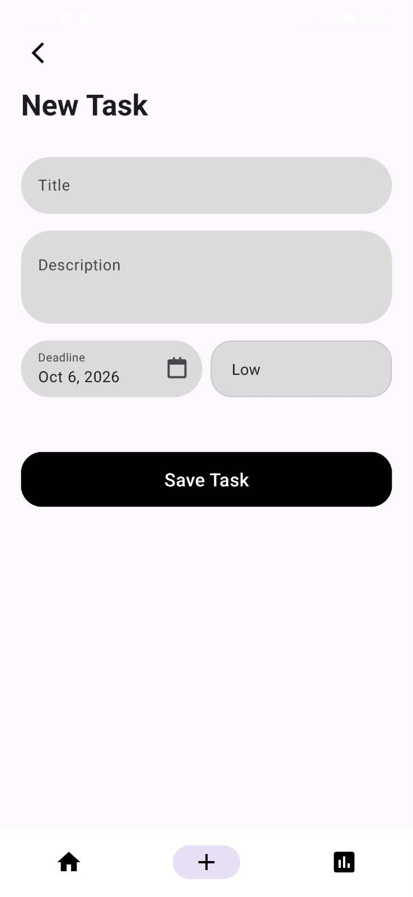
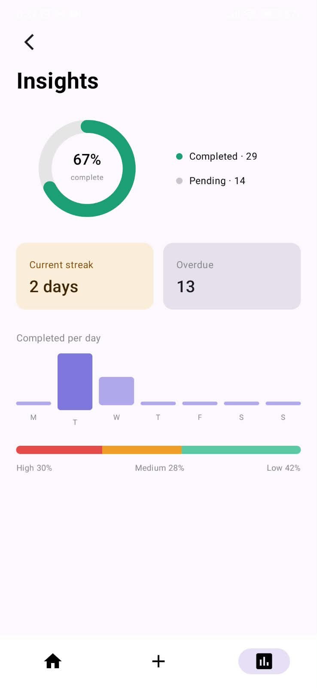

# 📝 Taskito

<p align="center">
  
  
  
  
  
  
</p>

**Taskito** is a sleek, modern Android productivity application built with Kotlin, Jetpack Compose, Material Design 3, and Room Database. It helps users organize daily tasks, set priorities and deadlines, track productivity habits, and analyze completion metrics with intuitive charts and insights.

---

## 📱 App Preview & Screenshots

<div align="center">
  <table>
    <tr>
      <td align="center" width="33%">
        <b>📅 Calendar & Task List</b><br/><br/>
        
      </td>
      <td align="center" width="33%">
        <b>➕ Add New Task</b><br/><br/>
        
      </td>
      <td align="center" width="33%">
        <b>📊 Analytics & Insights</b><br/><br/>
        
      </td>
    </tr>
  </table>
</div>

---

## ✨ Features

- **📅 Interactive Calendar & Day View:** Browse and manage tasks for any selected date on the calendar.
- **⚡ Swipe-to-Delete with Undo:** Easily delete tasks with a left swipe and restore them instantly with Snackbar Undo.
- **🏷️ Priority & Color Tagging:** Assign priority levels (High, Medium, Low) and custom color tags to structure your workflow.
- **🎯 Task Deadlines:** Select task due dates using a Material Date Picker dialog.
- **📊 Productivity Insights & Analytics (Compose):**
  - **Completion Rate Gauge:** Real-time percentage indicator of finished vs. pending tasks.
  - **Streak & Overdue Counter:** Track active streaks and monitor overdue obligations.
  - **Weekly Activity Chart:** Custom Compose bar graph showing daily completion activity (Mon–Sun).
  - **Priority Breakdown:** Visual distribution bar of high, medium, and low priority tasks.
- **💾 Offline First:** Persistent data storage using Room DB and Kotlin Flow for real-time UI updates.

---

## 🛠️ Tech Stack & Architecture

- **Language:** 100% [Kotlin](https://kotlinlang.org/)
- **UI Framework:** [Jetpack Compose](https://developer.android.com/jetpack/compose) & Material Design 3 XML Views
- **Architecture:** MVVM (Model-View-ViewModel) + Unidirectional Data Flow
- **Local Database:** [Room Database](https://developer.android.com/training/data-storage/room) with KSP
- **Asynchronous Programming:** Kotlin Coroutines & `StateFlow`
- **Navigation:** AndroidX Jetpack Navigation Component
- **Build System:** Gradle KTS with Version Catalog (`libs.versions.toml`), AGP 9.4+

---

## 📁 Repository Structure

```
Taskito2/
├── app/
│   ├── src/main/java/com/example/taskito/
│   │   ├── analytics/        # Jetpack Compose Insights & Charts
│   │   ├── db/               # Room Database, DAO & App Database
│   │   ├── model/            # Data Models (Task) & Repository
│   │   ├── view/             # Fragments, Host, AddTask & Adapters
│   │   └── viewmodel/        # TaskViewModel & Factory
│   └── src/main/res/         # XML layouts, navigation graph & drawables
├── screenshots/              # High-resolution app preview screenshots
└── README.md
```

---

## 🚀 Getting Started

### Prerequisites
- Android Studio Ladybug or newer
- JDK 11 or higher
- Android SDK 24+

### Installation
1. Clone the repository:
   ```bash
   git clone https://github.com/your-username/Taskito.git
   cd Taskito
   ```
2. Open the project in **Android Studio**.
3. Build the app:
   ```bash
   ./gradlew assembleDebug
   ```
4. Run the app on an emulator or connected device (Android 7.0 / SDK 24+).

---

## 📄 License

```
Copyright 2026 Taskito

Licensed under the Apache License, Version 2.0 (the "License");
you may not use this file except in compliance with the License.
You may obtain a copy of the License at

    http://www.apache.org/licenses/LICENSE-2.0

Unless required by applicable law or agreed to in writing, software
distributed under the License is distributed on an "AS IS" BASIS,
WITHOUT WARRANTIES OR CONDITIONS OF ANY KIND, either express or implied.
See the License for the specific language governing permissions and
limitations under the License.
```
